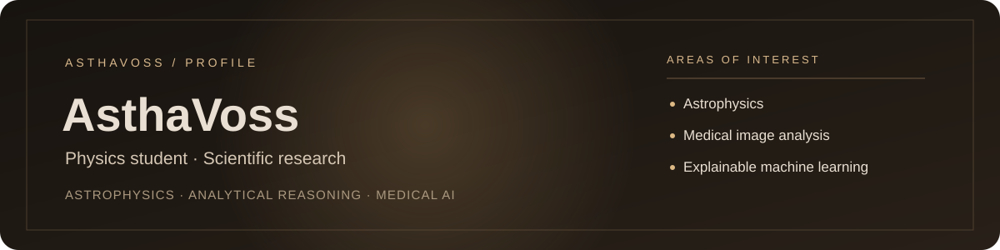

  

  
  

---

### Hi! 👋

I’m a physics student interested in astrophysics, analytical reasoning, and scientific research. I’m also exploring medical AI, biomedical imaging, and explainable machine learning.

- 🔭 **Exploring** — medical and biomedical AI
- 🔬 **Interested in** — radiology, medical image analysis, and explainable AI
- 🧠 **Studying** — machine learning, deep learning, and scientific computing
- 🌌 **Also curious about** — astrophysics and analytical problem-solving

### Research interests

| Area | Topics |
| --- | --- |
| Medical AI | Biomedical AI, radiology, medical image analysis |
| Machine learning | Deep learning, explainable AI |
| Scientific research | Scientific computing, analytical reasoning |
| Physics | Astrophysics |

**Current public repository**

| Repository | Description |
| --- | --- |
| [AsthaVoss](https://github.com/AsthaVoss/AsthaVoss) | This profile repository; a place to share research interests and future public work. |

---

### GitHub

  

  <picture>
    <source media="(prefers-color-scheme: dark)" srcset="https://raw.githubusercontent.com/AsthaVoss/AsthaVoss/output/github-snake-dark.svg">
    <source media="(prefers-color-scheme: light)" srcset="https://raw.githubusercontent.com/AsthaVoss/AsthaVoss/output/github-snake.svg">
    
  </picture>

